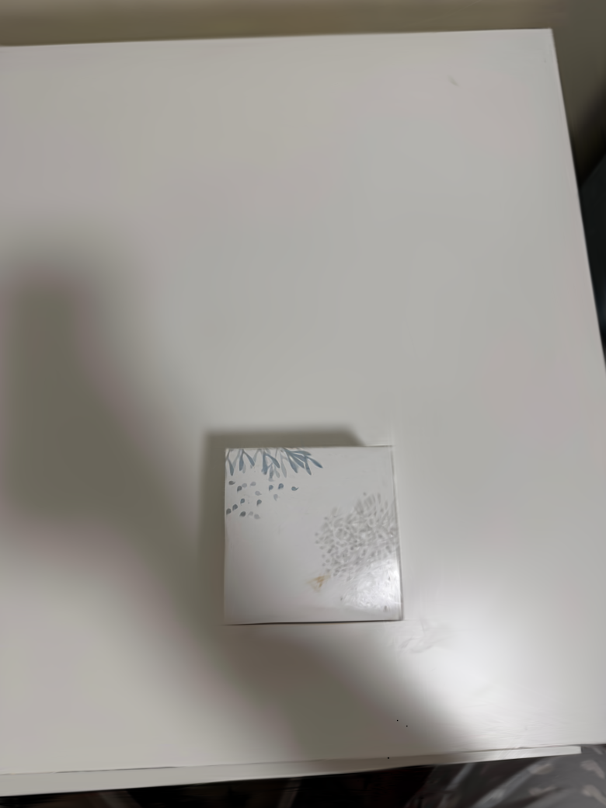
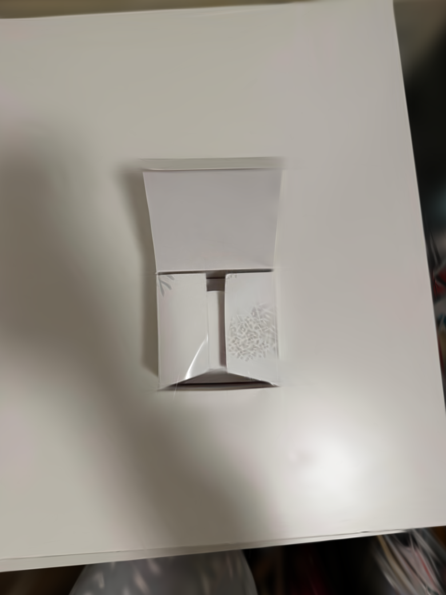

## Résultats de reconstruction 3D par Gaussian Splatting

### 1. Protocole expérimental et jeu de données
- **Données d'entrée** : 9 images présentant des résolutions hétérogènes (`960x1280`, `1280x960` et `3120x4160`), stockées dans `splatting_data/images/` (et sources brutes dans `splatting_data/raw_images/`).
- **Estimation des poses et nuage initial (COLMAP SfM)** : configuration multi-caméras (`single_camera = 0`) avec le modèle `SIMPLE_PINHOLE` afin d'accepter les différentes résolutions. Les 9 images ont été connectées avec succès (paire initiale `[7, 8]`), produisant **113 points 3D initiaux** et un coût final d'ajustement de faisceaux (*bundle adjustment*) de **2,20133 px**.
- **Environnement d'entraînement** : exécution sur **Google Colab** équipée d'un GPU **NVIDIA Tesla T4** (en respectant une contrainte cible de mémoire vidéo ≤ 12 Go VRAM), avec un facteur de sous-échantillonnage de résolution `-r 4` et un correctif d'inclusion `<cstdint>` dans `rasterizer_impl.h` pour assurer la compilation CUDA.

### 2. Performances et métriques (3 000 itérations)

| Paramètre / Métrique | Valeur observée |
| :--- | :--- |
| **Nombre d'images connectées (COLMAP)** | 9 / 9 |
| **Paire initiale SfM** | `[7, 8]` |
| **Coût final bundle adjustment** | `2.20133 px` |
| **Points 3D initiaux** | `113` |
| **GPU / Contrainte VRAM** | NVIDIA Tesla T4 (≤ 12 Go) |
| **Facteur de résolution** | `-r 4` |
| **Itérations d'entraînement** | `3000` |
| **Loss finale** | `0.0105611` |
| **Taille de `point_cloud.ply`** | `5.1M` |
| **Rendus d'entraînement exportés** | `00000.png` (282 Ko), `00001.png` (304 Ko) |

Les métriques détaillées sont consignées dans `results/tables/metrics_3k.json`.

### 3. Analyse qualitative des rendus et organisation du dépôt
Après l'optimisation sur 3 000 itérations, le rendu des vues d'entraînement a produit les captures `00000.png` et `00001.png`, versées dans `results/figures/` :

- 
- 

Avec un jeu de données réduit à 9 vues hétérogènes et un nuage initial parcimonieux de 113 points, 3 000 itérations permettent déjà de valider l'ensemble de la chaîne (SfM, compilation des extensions CUDA `diff-gaussian-rasterization`, `simple-knn` et `fused-ssim`, optimisation et rendu) tout en maîtrisant la mémoire GPU. Les zones peu couvertes par les angles de prise de vue ou présentant des détails fins restent les principales pistes d'amélioration lors d'une montée en itérations (par exemple 7 000 itérations).

Sur le plan de l'ingénierie logicielle, le dépôt Git (`Wiame2004/projet-3d-gen-splatting`) conserve uniquement les données d'entrée légères, les figures (`results/figures/`) et les tableaux de métriques (`results/tables/metrics_3k.json`), tandis que les fichiers 3D volumineux (`*.ply`, `*.splat`, checkpoints) et dossiers temporaires d'exécution sont exclus via `.gitignore`.
